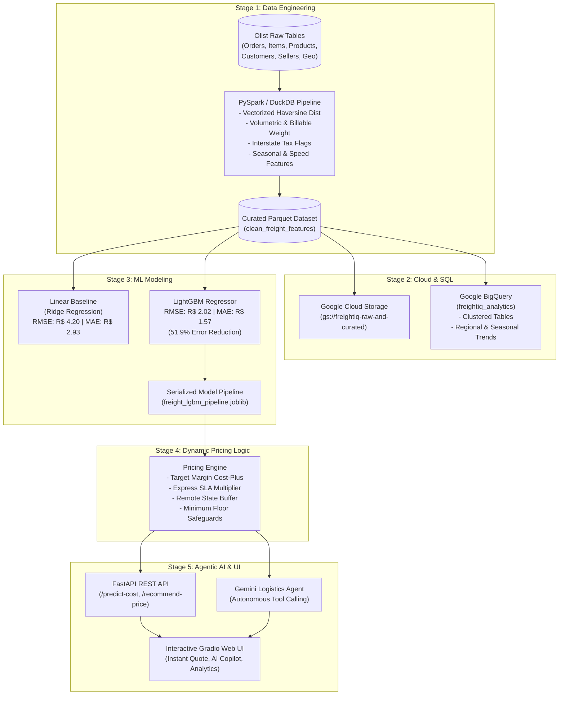

# 🚚 FreightIQ: AI-Powered Shipping Price Recommendation Engine

[](https://www.python.org/)
[](https://spark.apache.org/)
[](https://cloud.google.com/)
[](https://lightgbm.readthedocs.io/)
[](https://ai.google.dev/)
[](https://fastapi.tiangolo.com/)
[](https://gradio.app/)

> **FreightIQ** is an enterprise-grade transportation pricing intelligence system built on the **Olist Brazilian E-Commerce dataset**. Describe any shipment (weight, dimensions, origin, destination, SLA delivery speed, and target margin), and FreightIQ:
> 1. Predicts carrier baseline cost with sub-7% MAPE using LightGBM.
> 2. Recommends commercial quotes with dynamic risk, interstate tax, and SLA urgency surcharges.
> 3. Deploys an autonomous **Gemini AI Agent with tool calling** to explain the recommendation in plain English and defend profit margins.

---

## 🏗️ End-to-End System Architecture



---

## 🚀 The 5 Stages of FreightIQ

### Stage 1: Data Pipeline (PySpark & DuckDB)
- **Multi-Table Distributed Joins**: Integrates `orders`, `order_items`, `products`, `customers`, `sellers`, and `geolocation` datasets.
- **Geospatial Feature Engineering**: Computes true great-circle Haversine distance ($d$ in km) between customer and seller zip code centroids.
- **Dimensional Volumetric Weight**: Implements IATA standard volumetric cubic weight ($L \times H \times W / 6000$) to calculate **billable weight** ($\max(\text{actual}, \text{volumetric})$).
- **Dual Engine Execution**: Includes distributed **PySpark** ETL (`src/pipeline/pyspark_pipeline.py`) for enterprise cluster deployments and high-speed **DuckDB** (`src/pipeline/duckdb_pipeline.py`) for zero-overhead local execution.

### Stage 2: Cloud & SQL (GCP BigQuery & Cloud Storage)
- **GCS Data Lake Sync**: Scripted staging pipeline (`src/cloud/gcs_uploader.py`) to stream raw and curated parquet files to Google Cloud Storage.
- **BigQuery Analytical Schema**: Production table definitions with partitioning by purchase date and clustering by `seller_state`, `customer_state`, and `weight_band`.
- **Advanced SQL Analytics**:
  - `sql/freight_trends_by_region_and_season.sql`: Regional freight cost per ton-kilometer, freight-to-price ratio, and Q4 Black Friday holiday surge.
  - `sql/lane_profitability_and_speed.sql`: Express SLA delivery cost premiums across top Brazilian corridors (SP->RJ, SP->MG, SP->BA).

### Stage 3: Machine Learning & Benchmarking
Rigorous side-by-side comparison between Linear Regression baseline and LightGBM:

| Metric | Linear Baseline (Ridge) | LightGBM Regressor | Improvement |
| :--- | :---: | :---: | :---: |
| **Root Mean Squared Error (RMSE)** | R$ 4.20 | **R$ 2.02** | **51.92% lower error** |
| **Mean Absolute Error (MAE)** | R$ 2.93 | **R$ 1.57** | **46.37% lower error** |
| **$R^2$ Score** | 0.9606 | **0.9909** | **Superior Fit** |
| **Mean Absolute % Error (MAPE)** | 15.20% | **6.32%** | **Sub-7% Error Rate** |

#### Top Feature Importances (Information Gain Splits):
1. `billable_weight_kg` (1,779 splits)
2. `distance_km` (1,513 splits)
3. `actual_weight_kg` (1,198 splits)
4. `estimated_delivery_days` (956 splits)
5. `volumetric_weight_kg` (757 splits)

### Stage 4: Dynamic Pricing Logic Engine
Transforms baseline operational costs into profitable commercial quotes:
$$\text{Recommended Price} = \max\left(\frac{\text{Predicted Cost}}{1 - \text{Target Margin Pct}} \times \prod(1 + \text{Surcharge}_i), \quad \text{Floor Price}\right)$$
- **Express SLA Surcharge**: +18% linehaul premium for $\le 3$-day delivery commitments.
- **Remote Corridor Contingency**: +10% risk buffer for northern/riverine states (AM, PA, MT).
- **Interstate Border Buffer**: +4% to cover interstate ICMS tax and cross-docking overhead.
- **Financial Floor**: Guaranteed 5% profit floor to prevent carrier underquoting.

### Stage 5: Autonomous Gemini Agent, FastAPI & Gradio App
- **Gemini Agent with Tool Calling**: Dynamically binds `predict_shipping_cost`, `calculate_target_price`, and `get_lane_analytics`.
- **FastAPI Backend**: Microservice endpoints with full OpenAPI/Swagger documentation at `http://localhost:8000/docs`.
- **Interactive Gradio Web Dashboard**: 4-tab interactive interface with live quote cards, margin sliders, copilot chat, and BigQuery analytics.

---

## ⚡ Quickstart & Installation

### 1. Clone the Repository
```bash
git clone https://github.com/Roshanraj2580/FreightIQ.git
cd FreightIQ
```

### 2. Install Dependencies
```bash
pip install -r requirements.txt
```

### 3. Environment Configuration
```bash
cp .env.example .env
# Edit .env and insert your GEMINI_API_KEY (optional, agent includes autonomous fallback)
```

### 4. Run Entire Pipeline End-to-End
```bash
python run.py --stage all
```

### 5. Launch Interactive Web UI
```bash
python run.py --mode ui --port 7860
```
Open **http://localhost:7860** in your browser to test the live pricing dashboard!

### 6. Launch FastAPI REST Server
```bash
python run.py --mode api --port 8000
```
Access the interactive API documentation at **http://localhost:8000/docs**.

---

## 🧪 Running Automated Unit Tests
```bash
python -m pytest -o pythonpath=. tests/
```
All 5 automated tests validate cost-plus margin guarantees, express delivery premiums, floor prices, and ML inference predictions.

---

## 📁 Repository Structure

```
FreightIQ/
├── data/
│   ├── raw/                      # Olist CSV tables
│   └── processed/                # Curated Parquet & analytics summaries
├── models/
│   ├── freight_lgbm_pipeline.joblib   # Serialized LightGBM pipeline
│   ├── freight_lr_pipeline.joblib     # Baseline Ridge pipeline
│   ├── model_metrics.json             # Benchmark comparison & stats
│   └── feature_metadata.json          # Encoders & feature catalog
├── sql/
│   ├── freight_trends_by_region_and_season.sql
│   └── lane_profitability_and_speed.sql
├── src/
│   ├── pipeline/
│   │   ├── pyspark_pipeline.py   # Distributed PySpark ETL
│   │   ├── duckdb_pipeline.py    # Vectorized DuckDB pipeline
│   │   └── data_generator.py     # Olist data synthesizer & loader
│   ├── cloud/
│   │   ├── gcs_uploader.py       # Google Cloud Storage sync
│   │   ├── bigquery_loader.py    # Google BigQuery table loader
│   │   └── run_analytics.py      # Dual-mode SQL analytics runner
│   ├── modeling/
│   │   ├── train.py              # ML training, evaluation, & stats
│   │   └── predict.py            # High-speed inference engine
│   ├── pricing/
│   │   └── pricing_engine.py     # Dynamic cost-plus & risk logic
│   ├── agent/
│   │   ├── tools.py              # Gemini tool calling definitions
│   │   └── freight_agent.py      # AI Copilot reasoning & synthesis
│   └── api/
│       └── main.py               # FastAPI REST microservice
├── ui/
│   └── app_gradio.py             # Gradio 4-tab interactive dashboard
├── tests/
│   └── test_pricing.py           # Automated unit tests
├── requirements.txt
├── .env.example
├── .gitignore
├── run.py                        # Unified launcher CLI
└── README.md
```

---

## 👤 Author
**Roshan Raj**  
- GitHub: [@Roshanraj2580](https://github.com/Roshanraj2580)
- Repository: [https://github.com/Roshanraj2580/FreightIQ](https://github.com/Roshanraj2580/FreightIQ)
